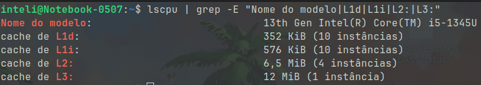
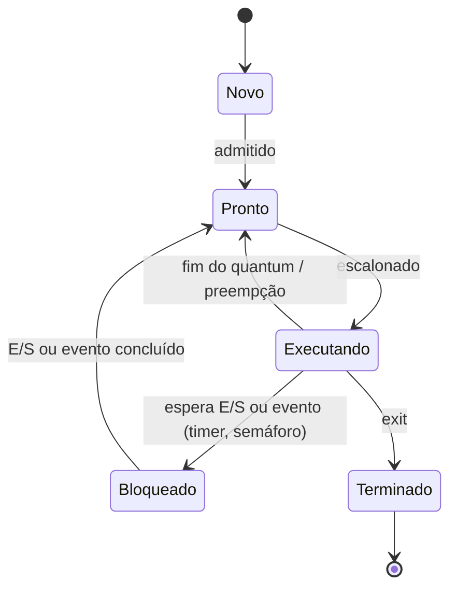
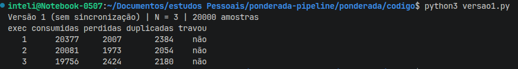
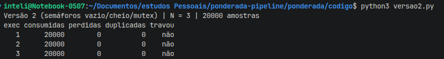
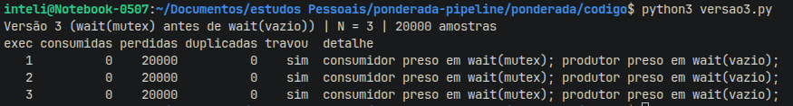
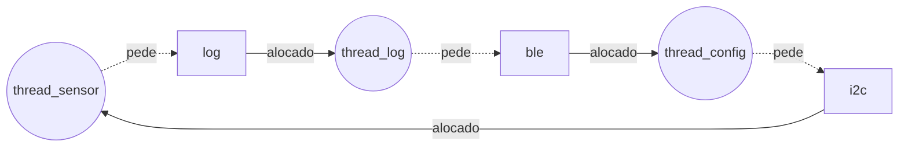

**Francisco de Araujo Ferreira Filho — D1 = 9, D2 = 0, N = 3**

# Ponderada CC08: do pipeline ao deadlock — Tato

## Parâmetros individuais

| Palavra | Letras |
| :-- | --: |
| Francisco | 9 |
| de | 2 |
| Araujo | 6 |
| Ferreira | 8 |
| Filho | 5 |
| **Total** | **30** |

- **D1** = letras do primeiro nome = 9
- **D2** = último dígito de 30 = 0

| Parâmetro | Conta | Valor |
| :-- | :-- | :-- |
| IC | 100.000 + 20.000 × 0 | **100.000 instruções** |
| m | 3% + 0,5% × 9 | **7,5%** |
| N | 3 + (0 mod 5) | **3 posições** |

---

# Parte A: o problema técnico

## A1. Arquitetura e memória: qual processador vai na pulseira?

### A1.1 Plataforma H

```
T_H = IC × CPI / f
    = 100.000 × 1,5 / 48.000.000 Hz
    = 150.000 ciclos / 48.000.000 Hz
    = 3,125 ms
```

**Atende:** 3,125 ms ≤ 5 ms, com folga de 1,875 ms. Sem sistema operacional e sem cache, esse tempo é **determinístico**: é o mesmo em toda amostra.

### A1.2 Plataforma V

AMAT (tempo médio de acesso à memória):

```
AMAT = tempo de acerto + m × penalidade
     = 1 + 0,075 × 120
     = 1 + 9
     = 10 ciclos
```

CPI efetivo:

```
CPI_ef = 1,0 + (acessos por instrução × m × penalidade)
       = 1,0 + 1,3 × 0,075 × 120
       = 1,0 + 11,7
       = 12,7
```

Tempo médio por amostra:

```
T_V = 100.000 × 12,7 / 1.200.000.000 Hz
    = 1.270.000 ciclos / 1,2 GHz
    = 1,058 ms
```

Pior caso, somando o atraso do Linux:

```
T_V,pior = 1,058 ms + 3 ms = 4,058 ms
```

**Atende, mas por pouco:** 4,058 ms ≤ 5 ms, com folga de apenas 0,942 ms. Com 1,2 GHz contra 48 MHz (25× mais clock), a V é só 3× mais rápida que a H no caso médio, porque o CPI sobe de 1,0 para 12,7: as faltas na cache comem 92% dos ciclos (11,7 de 12,7). E o pior caso depende de o Linux nunca passar dos 3 ms, o que não é garantido num kernel comum.

### A1.3 Acelerador DSP na Plataforma H (Lei de Amdahl)

Fração acelerada f = 0,6, fator de aceleração s = 5:

```
Speedup = 1 / ((1 − f) + f / s)
        = 1 / (0,4 + 0,6 / 5)
        = 1 / (0,4 + 0,12)
        = 1 / 0,52
        ≈ 1,923

T_H+DSP = 3,125 ms / 1,923 = 3,125 × 0,52 = 1,625 ms
```

**Atende com folga:** 1,625 ms, ou seja 3,375 ms de margem (67% do orçamento livre), e continua determinístico. Note que o speedup global (1,92×) fica bem abaixo dos 5× do DSP: os 40% que não são filtro passam a dominar.

### A1.4 Por que a V precisa de cache e a H não

Na V (Von Neumann), instruções e dados dividem um único barramento até a DRAM externa, que custa 120 ciclos: com 1,3 acessos por instrução, a CPU passaria quase todo o tempo esperando a memória. Esse é o gargalo de Von Neumann, e a cache L1 existe para escondê-lo. A H (Harvard) tem barramentos separados para instrução e dado e SRAM interna de 1 ciclo, então busca e dado chegam no mesmo ciclo sem disputa. Como a memória já anda no ritmo da CPU (48 MHz), não há gargalo para a cache esconder.

### A1.5 Evidência da minha máquina



```
Nome do modelo:   13th Gen Intel(R) Core(TM) i5-1345U
cache de L1d:     352 KiB (10 instâncias)
cache de L1i:     576 KiB (10 instâncias)
cache de L2:      6,5 MiB (4 instâncias)
cache de L3:      12 MiB (1 instância)
```

Sim, a L1 é **dividida** em L1i (instruções) e L1d (dados). Então o processador é **Harvard modificado**: no nível da L1 instruções e dados têm caminhos separados, como na Harvard, o que permite buscar uma instrução e um dado no mesmo ciclo. Já L2, L3 e a RAM são **unificadas**, e programa e dados ficam na mesma memória principal, como na Von Neumann (é isso que permite carregar um programa como dado e depois executá-lo). Para o programador, a máquina é Von Neumann; por dentro, o núcleo é Harvard.

---

## A2. Pipeline: o loop do filtro

```
I1  lw   x5, 0(x10)
I2  add  x6, x6, x5
I3  lw   x7, 0(x11)
I4  sub  x6, x6, x7
I5  sw   x6, 0(x12)
I6  addi x10, x10, 4
I7  addi x11, x11, 4
```

### A2.1 Dependências RAW

| Consumidora | Produtora | Registrador | Tipo |
| :-- | :-- | :-- | :-- |
| I2 `add` | I1 `lw` | x5 | load-use |
| I4 `sub` | I2 `add` | x6 | ALU → ALU |
| I4 `sub` | I3 `lw` | x7 | load-use |
| I5 `sw` | I4 `sub` | x6 | ALU → store |

I6 e I7 escrevem x10 e x11, que I1 e I3 leem antes. Isso é WAR (anti-dependência), não RAW, e não causa bolha num pipeline em ordem.

### A2.2 Sem forwarding

Como o banco de registradores escreve na primeira metade do ciclo e lê na segunda, a dependente pode fazer ID **no mesmo ciclo** do WB da produtora. `--` = bolha (instrução parada esperando o operando).

| Instr. | 1 | 2 | 3 | 4 | 5 | 6 | 7 | 8 | 9 | 10 | 11 | 12 | 13 | 14 | 15 | 16 | 17 |
| :-- | -- | -- | -- | -- | -- | -- | -- | -- | -- | -- | -- | -- | -- | -- | -- | -- | -- |
| I1 lw x5 | IF | ID | EX | MEM | WB | | | | | | | | | | | | |
| I2 add | | IF | -- | -- | ID | EX | MEM | WB | | | | | | | | | |
| I3 lw x7 | | | | | IF | ID | EX | MEM | WB | | | | | | | | |
| I4 sub | | | | | | IF | -- | -- | ID | EX | MEM | WB | | | | | |
| I5 sw | | | | | | | | | IF | -- | -- | ID | EX | MEM | WB | | |
| I6 addi | | | | | | | | | | | | IF | ID | EX | MEM | WB | |
| I7 addi | | | | | | | | | | | | | IF | ID | EX | MEM | WB |

- I2 espera x5 do WB de I1 (ciclo 5): 2 bolhas.
- I4 espera x6 (WB de I2, ciclo 8) e x7 (WB de I3, ciclo 9): ID no ciclo 9, 2 bolhas.
- I5 espera x6 do WB de I4 (ciclo 12): 2 bolhas.

**Total: 17 ciclos** (11 ideais + 6 bolhas).

### A2.3 Com forwarding

| Instr. | 1 | 2 | 3 | 4 | 5 | 6 | 7 | 8 | 9 | 10 | 11 | 12 | 13 |
| :-- | -- | -- | -- | -- | -- | -- | -- | -- | -- | -- | -- | -- | -- |
| I1 lw x5 | IF | ID | EX | MEM | WB | | | | | | | | |
| I2 add | | IF | ID | -- | EX | MEM | WB | | | | | | |
| I3 lw x7 | | | | IF | ID | EX | MEM | WB | | | | | |
| I4 sub | | | | | IF | ID | -- | EX | MEM | WB | | | |
| I5 sw | | | | | | | IF | ID | EX | MEM | WB | | |
| I6 addi | | | | | | | | IF | ID | EX | MEM | WB | |
| I7 addi | | | | | | | | | IF | ID | EX | MEM | WB |

- I2 recebe x5 por forwarding MEM/WB → EX (ciclo 5): 1 bolha.
- I4 recebe x7 por forwarding MEM/WB → EX (ciclo 8): 1 bolha. O x6 de I2 já foi escrito no ciclo 7.
- I5 recebe x6 de I4 por forwarding EX/MEM: sem bolha.

**Total: 13 ciclos** (11 ideais + 2 bolhas).

**O que continua causando bolha:** as duas dependências **load-use** (I1 → I2 por x5 e I3 → I4 por x7). O `lw` só tem o dado no **fim do estágio MEM**, e a instrução seguinte precisa dele no **início do EX**, que acontece no mesmo ciclo. O forwarding não volta no tempo: dá para encaminhar o valor para o EX do ciclo seguinte, não para o do mesmo ciclo. Por isso sobra 1 bolha em cada uma.

### A2.4 Reordenação sem bolhas

Basta subir o segundo `lw`, para que cada load fique a duas instruções de distância de quem usa o valor:

```
J1  lw   x5, 0(x10)     # lê a amostra nova
J2  lw   x7, 0(x11)     # lê a amostra mais antiga   (subiu)
J3  add  x6, x6, x5     # soma += nova
J4  sub  x6, x6, x7     # soma -= antiga
J5  sw   x6, 0(x12)     # grava a soma
J6  addi x10, x10, 4
J7  addi x11, x11, 4
```

O resultado não muda: os dois `lw` leem x10 e x11 antes de os `addi` os alterarem, e a ordem `add` → `sub` → `sw` sobre x6 é a mesma.

| Instr. | 1 | 2 | 3 | 4 | 5 | 6 | 7 | 8 | 9 | 10 | 11 |
| :-- | -- | -- | -- | -- | -- | -- | -- | -- | -- | -- | -- |
| J1 lw x5 | IF | ID | EX | MEM | WB | | | | | | |
| J2 lw x7 | | IF | ID | EX | MEM | WB | | | | | |
| J3 add | | | IF | ID | EX | MEM | WB | | | | |
| J4 sub | | | | IF | ID | EX | MEM | WB | | | |
| J5 sw | | | | | IF | ID | EX | MEM | WB | | |
| J6 addi | | | | | | IF | ID | EX | MEM | WB | |
| J7 addi | | | | | | | IF | ID | EX | MEM | WB |

- J3 precisa de x5 no EX (ciclo 5): J1 terminou MEM no ciclo 4, forwarding MEM/WB → EX.
- J4 precisa de x7 no EX (ciclo 6): J2 terminou MEM no ciclo 5, forwarding MEM/WB → EX; x6 vem de J3 por EX/MEM.
- J5 recebe x6 de J4 por EX/MEM.

**Total: 11 ciclos, zero bolhas** (5 estágios + 7 − 1).

| Cenário | Ciclos |
| :-- | --: |
| Sem forwarding | 17 |
| Com forwarding | 13 |
| Com forwarding + reordenado | 11 |

---

## A3. Processos e threads: como organizar o software

### A3.1 Organização proposta

| Tarefa | Onde roda | Por quê |
| :-- | :-- | :-- |
| Ler o sensor | Thread do **processo principal** | Caminho crítico de 5 ms |
| Processar a amostra | Thread do **processo principal** | Caminho crítico |
| Acionar o motor | Thread do **processo principal** | Caminho crítico |
| BLE (log + comandos) | **Processo separado** | Fala com o mundo externo |

- **Compartilhamento de memória:** sensor, processamento e motor trocam uma amostra a cada 10 ms pelo buffer circular. Como threads, elas veem o mesmo espaço de endereçamento, e passar a amostra é escrever numa posição do buffer, sem cópia e sem chamada ao sistema. O BLE só precisa de um resumo (log), que pode ir por um pipe ou uma fila de mensagens, sem pressa.
- **Custo de criação e troca de contexto:** trocar entre threads do mesmo processo não troca a tabela de páginas nem invalida a TLB, então é bem mais barato que trocar entre processos. Isso importa num orçamento de 5 ms em que o pior caso da V já ocupa 4,058 ms. Criar processos é caro, mas acontece uma vez só, no boot.
- **Isolamento de falhas:** se a thread do BLE travar ou corromper memória, ela leva junto o processo inteiro, e com ele o motor. Como processo separado, uma falha no BLE derruba só o BLE; o sistema reinicia o processo e a vibração continua.

### A3.2 BLE explorado: thread ou processo?

- **Como thread:** quem explora a falha roda código **dentro do processo principal**, com acesso a toda a memória: pode ler e alterar o buffer de amostras, mudar a sensibilidade, desligar o motor ou travá-lo. A pessoa passa a andar sem aviso de obstáculo, ou com aviso falso.
- **Como processo separado:** o atacante fica preso no espaço de endereçamento do BLE. A memória do processo principal está protegida pela MMU, e o único caminho até ele é a interface de comunicação entre processos, que pode validar cada comando (faixas de valores permitidas, por exemplo). O processo BLE ainda pode rodar com menos privilégios. O estrago máximo é perder o log ou a configuração, não o aviso de obstáculo.

### A3.3 Diagrama de estados



A thread do sensor passa a maior parte do tempo **Bloqueada**. Ela acorda a cada 10 ms (timer ou interrupção do sensor), lê uma amostra, coloca no buffer e volta a dormir esperando o próximo período ou o `wait(vazio)`. Ler o sensor leva microssegundos e o processamento inteiro leva cerca de 1 ms (A1.2), então em cada janela de 10 ms ela fica bloqueada mais de 90% do tempo. É uma tarefa limitada por E/S, não por CPU.

---

## A4. Código com semáforos: o buffer entre o sensor e o motor

Código em [`codigo/`](codigo/), Python 3 com `threading`, buffer circular de **N = 3**, 20.000 amostras. Cada versão roda as 3 execuções com um comando:

```
python3 ponderada/codigo/versao1.py
python3 ponderada/codigo/versao2.py
python3 ponderada/codigo/versao3.py
```

- **Consumidas:** quantas leituras o consumidor fez.
- **Perdidas:** números de 0 a 19.999 que nunca chegaram ao consumidor.
- **Duplicadas:** leituras repetidas de uma amostra já lida.
- **Travou:** alguma thread ficou 1 s sem conseguir avançar.

### Resultados

| Versão | Execução | Consumidas | Perdidas | Duplicadas | Travou |
| :-- | :-: | --: | --: | --: | :-: |
| 1 (sem sincronização) | 1 | 20.377 | 2.007 | 2.384 | não |
| 1 (sem sincronização) | 2 | 20.081 | 1.973 | 2.054 | não |
| 1 (sem sincronização) | 3 | 19.756 | 2.424 | 2.180 | não |
| 2 (semáforos) | 1 | 20.000 | 0 | 0 | não |
| 2 (semáforos) | 2 | 20.000 | 0 | 0 | não |
| 2 (semáforos) | 3 | 20.000 | 0 | 0 | não |
| 3 (ordem trocada) | 1 | 0 | 20.000 | 0 | **sim** |
| 3 (ordem trocada) | 2 | 0 | 20.000 | 0 | **sim** |
| 3 (ordem trocada) | 3 | 0 | 20.000 | 0 | **sim** |

### Prints

Versão 1:



Versão 2:



Versão 3:



### Região crítica da versão 1

A região crítica é a **atualização do contador `ocupadas`**, junto com a escrita e a leitura do buffer que ele controla:

```python
lido = estado["ocupadas"]        # 1. lê
time.sleep(0)                    # 2. é interrompida
estado["ocupadas"] = lido + 1    # 3. escreve (no consumidor: lido - 1)
```

`ocupadas += 1` não é atômico: são três passos (ler, calcular, escrever). Se o produtor lê 2, é interrompido, o consumidor lê 2 e grava 1, e então o produtor grava 3, o decremento do consumidor **se perdeu**. Agora o contador diz 3 posições ocupadas quando há 2.

- **Contador acima do real:** o consumidor acha que há amostra nova e lê uma posição que já tinha lido. Resultado: **duplicata**.
- **Contador abaixo do real:** o produtor acha que há espaço e escreve por cima de uma amostra que o consumidor ainda não leu. Resultado: **perda**.

Como os dois erros acontecem, o número de consumidas fica perto de 20.000 (19.756 a 20.377), mas cerca de **10–12% das amostras** se perdem e o mesmo tanto chega duplicado. Na pulseira, isso é o motor vibrando com uma leitura velha e deixando de vibrar para uma nova, que pode ser a do poste.

Nessas execuções a versão 1 não travou: produtor e consumidor esperam o mesmo contador em condições opostas (`>= N` e `<= 0`), então nunca ficam os dois esperando ao mesmo tempo. O defeito dela é corromper os dados, não parar.

### O que cada semáforo garante na versão 2

| Semáforo | Valor inicial | Garante |
| :-- | :-: | :-- |
| `vazio` | N = 3 | O produtor só escreve se houver posição livre. Ele dorme quando o buffer está cheio, então **nenhuma amostra não lida é sobrescrita** (sem perdas). |
| `cheio` | 0 | O consumidor só lê se houver amostra nova. Ele dorme quando o buffer está vazio, então **nenhuma posição é lida duas vezes** (sem duplicatas). |
| `mutex` | 1 | **Exclusão mútua:** só uma thread por vez mexe no buffer e nos índices, mesmo com o `time.sleep(0)` dentro da região crítica. |

Além disso, `vazio` e `cheio` são contadores atômicos mantidos pelo próprio semáforo, substituindo o `ocupadas` frágil da versão 1, e as threads **dormem** em vez de fazer espera ocupada. Resultado: 20.000 consumidas, 0 perdidas e 0 duplicadas nas três execuções.

### O que aconteceu na versão 3

As três execuções **travaram (deadlock)** com o buffer cheio e nenhuma amostra consumida. A saída do programa mostra onde cada thread ficou presa: `consumidor preso em wait(mutex)` e `produtor preso em wait(vazio)`. O produtor dorme em `vazio` segurando o `mutex`, e o consumidor dorme esperando esse mesmo `mutex`.

1. O produtor enche as 3 posições (`vazio` chega a 0).
2. Na 4ª amostra, ele faz `wait(mutex)` e **consegue o mutex**.
3. Em seguida faz `wait(vazio)`: como `vazio` = 0, ele **dorme segurando o mutex**.
4. O consumidor faz `wait(cheio)` (há 3 amostras) e depois `wait(mutex)`, mas o mutex está com o produtor, então ele **dorme**.
5. Só o consumidor poderia fazer `signal(vazio)`, e ele só faz isso depois de pegar o mutex. Só o produtor poderia liberar o mutex, e ele só faz isso depois de passar do `vazio`. **Espera circular: ninguém avança.**

Nas três execuções o consumidor ficou com 0 amostras: o produtor encheu o buffer e pegou o mutex antes de o consumidor rodar pela primeira vez. A ordem exata depende do escalonador: se o timeout do produtor estourar antes, ele devolve o mutex e o consumidor ainda pode ler 1 amostra antes de ver a flag de travamento; nesse caso a saída lista só o produtor. Sem o timeout de 1 s, o programa ficaria parado para sempre, que é exatamente a pulseira congelada.

A regra: **pegue o semáforo de recurso (`vazio`/`cheio`) antes do mutex**. Nunca durma esperando um recurso enquanto segura o mutex.

---

## A5. Deadlock: a pulseira congelou

```
thread_sensor:   P(i2c) → le_sensor()     → P(log) → registra()      → V(log) → V(i2c)
thread_log:      P(log) → le_log()        → P(ble) → envia()         → V(ble) → V(log)
thread_config:   P(ble) → recebe_comando() → P(i2c) → ajusta_sensor() → V(i2c) → V(ble)
```

### A5.1 Sequência que leva ao deadlock e grafo de alocação

| Passo | Thread | Ação | Estado |
| :-: | :-- | :-- | :-- |
| 1 | sensor | `P(i2c)` | pega i2c, começa `le_sensor()` |
| 2 | (troca) | | o escalonador passa a CPU para log |
| 3 | log | `P(log)` | pega log, começa `le_log()` |
| 4 | (troca) | | passa a CPU para config |
| 5 | config | `P(ble)` | pega ble, começa `recebe_comando()` |
| 6 | sensor | `P(log)` | log está com thread_log, **bloqueia** |
| 7 | log | `P(ble)` | ble está com thread_config, **bloqueia** |
| 8 | config | `P(i2c)` | i2c está com thread_sensor, **bloqueia** |

Depois do passo 8, as três estão bloqueadas e ninguém vai fazer um `V`. O grafo de alocação de recursos nesse instante (recurso → thread = alocado; thread → recurso = pedido):



```
thread_sensor ──pede──▶ [log] ──alocado──▶ thread_log
      ▲                                         │
  alocado                                     pede
      │                                         ▼
    [i2c] ◀──pede── thread_config ◀──alocado── [ble]
```

O grafo tem o ciclo **sensor → log → thread_log → ble → thread_config → i2c → sensor**. Como cada recurso tem uma única instância (semáforo binário), um ciclo no grafo **é** deadlock.

### A5.2 As quatro condições de Coffman no código

| Condição | Onde aparece |
| :-- | :-- |
| **Exclusão mútua** | i2c, log e ble são protegidos por semáforos binários: só uma thread por vez usa o barramento, o arquivo ou o rádio. |
| **Posse e espera** | Cada thread segura o primeiro recurso enquanto pede o segundo: sensor segura i2c e pede log; log segura log e pede ble; config segura ble e pede i2c. |
| **Sem preempção** | Um `P` bloqueia indefinidamente e só o dono faz o `V`. Nada tira i2c do sensor à força. |
| **Espera circular** | sensor espera log, que espera ble, que espera i2c, que está com o sensor. Cada thread pega os recursos numa ordem diferente: (i2c, log), (log, ble), (ble, i2c), e isso fecha o ciclo. |

### A5.3 Duas correções de tipos diferentes

**Correção 1: prevenção, com ordem global de aquisição (quebra a espera circular).**
Todos os recursos ganham uma ordem fixa: **i2c < log < ble**, e toda thread pede na ordem crescente:

```
thread_sensor:  P(i2c) → P(log)               (já estava na ordem)
thread_log:     P(log) → P(ble)               (já estava na ordem)
thread_config:  P(i2c) → P(ble) → recebe_comando() → ajusta_sensor() → V(ble) → V(i2c)
```

Só a `thread_config` muda. Como todo mundo sobe na mesma direção, nenhum ciclo pode se formar e o deadlock fica **impossível**, não apenas raro.
*Para quem usa a pulseira:* nada de congelamento. O custo é que, enquanto um comando de configuração é recebido, o i2c fica reservado e a leitura do sensor espera um pouco mais. Isso pode atrasar uma amostra durante a configuração, mas configurar é raro e acontece com a pessoa parada mexendo no celular. Quem usa não percebe nada no dia a dia.

**Correção 2: detecção e recuperação, com timeout no `P` e watchdog.**
Cada `P` passa a ter prazo (por exemplo, `P(log, timeout = 50 ms)`). Se estourar, a thread considera que houve deadlock, libera o que tem (`V` no primeiro recurso), registra o evento e tenta de novo após um tempo aleatório. Como última linha de defesa, um watchdog de hardware reinicia a pulseira se a thread do motor não "chutar" o watchdog dentro do prazo.
*Para quem usa a pulseira:* o congelamento deixa de ser permanente. Se o timeout resolver, perde-se no máximo algumas amostras (dezenas de ms sem atualização da vibração). Se precisar do watchdog, a pessoa fica alguns segundos sem vibração (avisada por um pulso longo) até a pulseira voltar. É melhor do que ficar travada até desligar e ligar, mas o risco não é zero: por alguns segundos ela anda sem aviso de obstáculo.

Prevenção elimina a causa; detecção e recuperação convive com ela e limita o estrago. Para um produto de segurança, a prevenção é a correção definitiva, e o watchdog fica como cinto de segurança.

---

# Parte B: a decisão do CTO

## Memorando — Dilema 2: qual processador vai para a produção

**Para:** Conselho da Tato
**De:** Francisco de Araujo Ferreira Filho, CTO
**Assunto:** Plataforma de produção

**Decisão: a Tato vai para a produção com a Plataforma H (microcontrolador Harvard) com o acelerador DSP, a R$ 37 por unidade.**

**Por quê.** Nosso produto é um aviso de obstáculo para quem não enxerga, e o único requisito inegociável é processar cada amostra em até 5 ms. Pelas minhas contas (Parte A1), a H com DSP processa uma amostra em **1,625 ms, sempre**: sem sistema operacional e sem cache, o tempo não varia. A Plataforma V faz 1,058 ms em média, mas **4,058 ms no pior caso**, porque o Linux pode interromper a tarefa por até 3 ms. Isso deixa 0,94 ms de folga, e essa folga depende de o Linux nunca passar dos 3 ms, o que um kernel comum não garante. Na H com DSP sobram 3,375 ms (67% do orçamento) para recursos futuros, como navegação, sem chegar perto do limite. Sem o DSP a H também passa (3,125 ms), mas pago os R$ 15 pela margem: ela é o que nos deixa crescer sem trocar de chip.

**Do que estou abrindo mão.**
- **Atualização pela internet (OTA).** Na H, corrigir firmware exige levar a pulseira à assistência técnica. Um bug em campo, como o deadlock da A5, é corrigido devagar: **o usuário** fica mais tempo com o bug ou sem a pulseira, e **a empresa** paga o recall. Para reduzir isso, o firmware já sai com watchdog e com a ordem global de aquisição da A5.
- **O ecossistema do Linux** (bibliotecas, pilha de rede, contratação mais fácil): o time escreve mais código à mão em C embarcado.
- Em troca, economizamos **R$ 33 por unidade**: R$ 66 mil nas primeiras 2.000 pulseiras, o que paga a assistência técnica do primeiro ano.

**Impacto em quem usa e risco de segurança.** Para o usuário, a H significa vibração no tempo certo em toda amostra, bateria que dura mais (48 MHz contra 1,2 GHz com DRAM) e boot quase instantâneo. Na segurança, a superfície de ataque cai muito: sem Linux, sem pilha IP, a única porta de entrada é o BLE. O risco que aceitamos é que, se surgir uma vulnerabilidade no BLE, **não conseguimos corrigir rápido**. Para mitigar, o BLE só aceita comandos com pareamento autenticado e valores em faixas fixas, e o código do sensor e do motor não depende de nada que chegue pelo rádio.

**O que me faria mudar de ideia.**
1. Se a V, rodando Linux com kernel de tempo real (PREEMPT_RT), tiver o pior caso **medido abaixo de 1 ms** num teste de 72 horas com carga máxima de BLE. Aí o pior caso total fica em torno de 2,1 ms, e a OTA passa a valer os R$ 33 a mais.
2. Se, no piloto das primeiras 2.000 pulseiras, precisarmos de **mais de 2 atualizações de firmware em campo nos primeiros 12 meses**. Nesse caso o custo de recall já supera a economia de R$ 66 mil e a próxima versão do hardware deve ter OTA.
